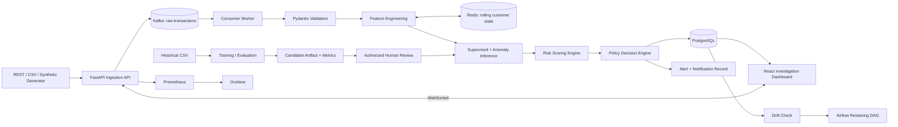

# Sentinel — Real-Time Fraud Detection & Risk Intelligence

A modular, event-driven reference implementation for detecting suspicious financial transactions, assigning explainable 0–100 risk scores, generating alerts, and supporting fraud investigations. It is designed to run locally with open-source components and reproducible synthetic data.

> **Important scope statement:** this repository is a runnable engineering foundation and demonstration, not a certified financial-grade production system. The included demo model is trained on synthetic data. Its metrics must never be represented as real-world fraud performance or used to make live financial decisions. Before production use, complete the security, operational, governance, data-retention, model-validation, and institution-specific controls listed in [Production hardening](#production-hardening).

## What is implemented

- FastAPI REST API with Pydantic validation, JWT access tokens, Argon2 password hashing, backend-enforced role permissions, and configurable per-IP request throttling.
- PostgreSQL persistence for normalized customers, accounts, merchants, devices, transactions, features, predictions, risk scores, alerts, investigations, audit records, model versions, drift reports, notification events, roles, and permissions.
- Kafka transaction ingestion with customer-keyed partition affinity, consumer-group processing, manual offset commits, bounded retries, and a dead-letter topic.
- Redis-backed rolling velocity features with a process-local fallback for lightweight development.
- Deterministic fallback risk logic and a bootstrapped RandomForest + IsolationForest demo artifact trained on synthetic events.
- Independent hybrid risk scoring and decision policies, alert deduplication, transparent risk-signal explanations, and best-effort SHAP TreeExplainer support for compatible tree artifacts.
- Synthetic historical data generation, CSV upload, Kafka replay, XGBoost/LightGBM temporal training comparison, candidate registration, drift-report generation, and an Airflow DAG template.
- React + TypeScript dashboard with transaction monitoring, alerts/investigation actions, model state, drift reports, Recharts visualizations, and WebSocket-based live updates.
- Docker Compose core stack plus optional Kafka UI, MLflow, MinIO, Prometheus/Grafana, Airflow, and Spark profiles.
- Unit tests for domain logic, authentication helpers, and the persisted prediction path.

The design intentionally starts with one deployable backend application plus a dedicated Kafka consumer thread rather than splitting every domain operation into a network microservice. Domain/service boundaries are kept separate in code; the consumer can be extracted into a worker deployment when throughput or independent scaling requires it.

## Architecture



### Main data flow

1. `POST /api/v1/transactions` validates a transaction and waits for Kafka's `acks=all` publish result before returning `202 queued`.
2. Kafka partitions by `customer_id`, preserving per-customer partition order for velocity calculations. `transaction_id` remains the deduplication identifier.
3. The consumer performs bounded processing retries. It commits the source offset after the database transaction succeeds. After three processing failures it writes the original message and error metadata to `dead-letter-transactions`; it commits only after that handoff succeeds.
4. The processor enriches dimensions, builds point-in-time rolling features, performs hybrid inference, calculates a separate risk score, applies a configurable policy, and writes predictions/risk/alerts to PostgreSQL in a database transaction.
5. The dashboard polls durable REST endpoints and receives newly committed transaction rows over WebSocket.

**Delivery semantics:** the local consumer is at-least-once, not exactly-once. Database uniqueness constraints and the `transaction_id` idempotency check protect duplicate processing. A production deployment should add an inbox/outbox pattern for cross-topic publishing, a managed schema registry, partition-rebalance tests, DLQ replay tooling, and broker ACLs.

## Project layout

```text
fraud-intelligence/
├── backend/
│   ├── app/
│   │   ├── api/                 # versioned REST endpoints
│   │   ├── auth/                # JWT, Argon2, RBAC
│   │   ├── core/                # settings, JSON logs, Prometheus metrics
│   │   ├── database/            # SQLAlchemy models and sessions
│   │   ├── schemas/             # request/response validation
│   │   ├── services/            # features, inference, score, decision, alerts
│   │   ├── streaming/           # Kafka producer/consumer
│   │   └── main.py
│   ├── migrations/              # Alembic baseline schema
│   ├── tests/
│   ├── Dockerfile
│   ├── requirements-core.txt
│   └── requirements-ml.txt
├── ml/
│   ├── features/
│   ├── training/                # XGBoost + LightGBM comparison
│   ├── evaluation/
│   ├── inference/
│   ├── anomaly_detection/
│   └── explainability/
├── streaming/schemas/           # JSON Schema and topic contracts
├── orchestration/airflow/dags/  # weekly retraining workflow template
├── monitoring/                  # reserved for monitoring extensions
├── infrastructure/              # Prometheus/Grafana provisioning
├── frontend/                    # React + TypeScript + Vite dashboard
├── scripts/                     # data generation, replay, model registration, drift
├── docs/
├── docker-compose.yml
├── dvc.yaml
├── params.yaml
└── .env.example
```

## Quick start — Docker Compose

### Prerequisites

- Docker Desktop (or Docker Engine) with Docker Compose v2.
- 8 GB RAM recommended for the core stack; optional Spark/Airflow/MLflow profiles require more.
- Ports `5432`, `6379`, `8000`, `8088`, and `29092` available.

### 1. Configure local environment

```bash
cp .env.example .env
```

Change `ADMIN_PASSWORD`, `JWT_SECRET_KEY`, and database/observability passwords before sharing the machine or exposing any port. The defaults are development-only.

### 2. Start the core services

```bash
docker compose up --build
```

The core stack starts PostgreSQL, Redis, Kafka, the API/consumer, and the dashboard. On first startup, the backend trains a compact synthetic RandomForest + IsolationForest artifact if none exists. This startup step is for a reproducible demo only.

Open:

| Service | URL |
|---|---|
| Dashboard | http://localhost:8088 |
| API / Swagger | http://localhost:8000/docs |
| API health | http://localhost:8000/health |
| Prometheus scrape endpoint | http://localhost:8000/api/v1/metrics |
| Kafka external listener | `localhost:29092` |

**Local bootstrap login:** defaults are `admin@local.test` and `ChangeMe-Local-Only-123!`. Use the values from your `.env` file. Change these credentials immediately for any shared or exposed environment.

### 3. Generate synthetic transaction data

In a new terminal, from the repository root:

```bash
# Backend dependencies are installed in the container; the host needs pandas/numpy for this script.
python -m venv .venv
# Windows PowerShell: .venv\Scripts\Activate.ps1
# macOS/Linux: source .venv/bin/activate
pip install -r backend/requirements-core.txt
python scripts/generate_data.py --rows 20000 --fraud-rate 0.012 --seed 42
```

This writes `data/synthetic_transactions.csv` (ignored by Git). The generator creates normal traffic and synthetic card-not-present, velocity, account/device takeover, and geographic/merchant anomaly patterns. Fraud prevalence is intentionally configurable and imbalanced.

### 4. Stream the CSV through Kafka

```bash
pip install kafka-python
python scripts/simulate_stream.py --input data/synthetic_transactions.csv --rate 20 --broker localhost:29092
```

For a quick test, limit the stream:

```bash
python scripts/simulate_stream.py --input data/synthetic_transactions.csv --rate 50 --limit 500 --broker localhost:29092
```

The consumer processes each event, persists the result, and updates the dashboard. Synthetic labels are retained for offline evaluation only; they are not used as live inference features.

### 5. Use the REST API directly

First obtain a token:

```bash
curl -X POST http://localhost:8000/api/v1/auth/token \
  -H "Content-Type: application/x-www-form-urlencoded" \
  -d "username=admin@local.test&password=ChangeMe-Local-Only-123!"
```

Then ingest a transaction (replace `<TOKEN>`):

```bash
curl -X POST http://localhost:8000/api/v1/transactions \
  -H "Authorization: Bearer <TOKEN>" \
  -H "Content-Type: application/json" \
  -d '{
    "transaction_id":"TXN-MANUAL-001",
    "customer_id":"CUS-MANUAL-001",
    "account_id":"ACC-MANUAL-001",
    "amount":125000,
    "currency":"INR",
    "merchant_id":"MER-ONLINE-001",
    "merchant_category":"electronics",
    "timestamp":"2026-11-27T10:30:00+05:30",
    "payment_method":"card",
    "device_id":"DEV-NEW-001",
    "ip_address":"203.0.113.10",
    "latitude":28.6139,
    "longitude":77.2090,
    "channel":"ecommerce",
    "transaction_status":"completed"
  }'
```

For direct synchronous scoring during development, use `POST /api/v1/fraud/predict`. For bulk historical data use `POST /api/v1/transactions/upload-csv` with a CSV containing the transaction event columns. The regular ingestion endpoint is the preferred path because it exercises Kafka.

## Optional infrastructure profiles

Start optional services in addition to the core stack:

```bash
# Kafka UI at http://localhost:8090
docker compose --profile tools up --build

# MLflow at http://localhost:5000 and MinIO console at http://localhost:9001
docker compose --profile mlops up --build

# Prometheus at http://localhost:9090 and Grafana at http://localhost:3001
docker compose --profile observability up --build

# Airflow at http://localhost:8080
docker compose --profile orchestration up --build

# Spark standalone master UI at http://localhost:8081
docker compose --profile analytics up --build
```

Profiles are independent; enable only the ones you need. Default Grafana local login is `admin` / `local-grafana-change-me` unless overridden in `.env`.

## Offline ML training

Install the ML toolchain in a Python 3.11 virtual environment:

```bash
pip install -r backend/requirements-ml.txt
python scripts/generate_data.py --rows 50000 --fraud-rate 0.015 --seed 123
python ml/training/train.py \
  --input data/synthetic_transactions.csv \
  --output artifacts/challenger.joblib
```

The trainer:

- Uses chronological 70% / 15% / 15% train/validation/test windows.
- Trains XGBoost and LightGBM when installed.
- Compares validation PR-AUC to select the challenger.
- Fits IsolationForest on the non-fraud portion of train+validation.
- Writes a joblib bundle and a JSON metrics report.

Metrics include precision, recall, F1, PR-AUC, ROC-AUC, false-positive rate, and false-negative rate. The implementation intentionally does not use accuracy as the primary selection metric. For a real deployment, tune thresholds against operational constraints and add precision/recall at K, calibration, expected loss, and segment-level fairness/stability evaluation.

Register the artifact as a candidate in the local PostgreSQL registry:

```bash
docker compose exec backend python scripts/register_model.py --artifact /app/artifacts/challenger.joblib
```

The artifacts directory is bind-mounted into the backend container, so the host-trained challenger is visible at `/app/artifacts/challenger.joblib`. Candidate registration is separate from model promotion. An authorized `administrator` or `ml_engineer` must review evidence and approve a promotion using the protected model promotion endpoint. The active inference process does not hot-reload newly promoted artifacts; deploy/restart the serving worker with the approved artifact through a controlled release process.

## Drift monitoring and retraining

Compare a trusted reference feature window with a recent production window:

```bash
python scripts/check_drift.py \
  --reference data/reference_features.csv \
  --current data/current_features.csv \
  --threshold 0.20
```

The script calculates a Population Stability Index (PSI)-style signal for numeric features and persists a report. PSI is a screening indicator, not proof of concept drift. Validate data quality, seasonality, class/segment composition, and labels before retraining. The Airflow DAG is a scheduled workflow template; adapt its mounted data paths, training environment, MLflow integration, challenger evaluation, and human-approval task to your deployment. Drift detection never auto-promotes a model.

## API overview

All application endpoints are under `/api/v1` except `/`, `/health`, and the FastAPI docs.

| Area | Endpoint | Purpose |
|---|---|---|
| Authentication | `POST /auth/token` | Obtain JWT access token |
| Transactions | `POST /transactions` | Validate and publish one transaction to Kafka |
| Transactions | `POST /transactions/bulk` | Publish a validated JSON batch |
| Transactions | `POST /transactions/upload-csv` | Validate and stream CSV rows |
| Transactions | `GET /transactions` | Search and paginate persisted transactions |
| Transactions | `GET /transactions/{transaction_id}` | Fetch a processed transaction |
| Fraud | `POST /fraud/predict` | Synchronous local scoring path |
| Fraud | `GET /fraud/predictions` | Recent fraud prediction records |
| Fraud | `GET /fraud/risk-distribution` | Risk category counts |
| Alerts | `GET /alerts` | Filter alert queue |
| Alerts | `PATCH /alerts/{alert_id}/status` | Update alert lifecycle status |
| Alerts | `POST /alerts/{alert_id}/assign` | Assign an investigator |
| Cases | `GET /cases` | List investigation cases |
| Cases | `POST /cases` | Create case from alert |
| Cases | `POST /cases/{case_id}/notes` | Add an investigation note |
| Analytics | `GET /analytics/overview` | Database-backed dashboard KPIs |
| Analytics | `GET /analytics/trends` | Daily volume and flagged counts |
| Models | `GET /models`, `GET /models/active` | Registry and active serving mode |
| Models | `POST /models/{model_id}/promote` | Record authorized candidate approval/rejection |
| Monitoring | `GET /monitoring/drift` | Stored drift reports |
| Monitoring | `GET /monitoring/data-quality` | Transaction quality counts |
| System | `GET /health` | Liveness probe |
| System | `GET /metrics` | Prometheus metrics |
| System | `GET /monitoring/system` | Component reachability snapshot |
| Streaming | `WS /ws/transactions` | Dashboard live transaction updates |

See [API documentation](docs/api_documentation.md) and the interactive OpenAPI page at `/docs` for request schemas and response examples.

## Local development without Docker

1. Start PostgreSQL, Redis, and Kafka locally (Kafka broker listener must be `localhost:9092`), or set the matching URLs in `.env`.
2. Install core dependencies: `pip install -r backend/requirements-core.txt`.
3. From the repository root, set `PYTHONPATH=backend` (PowerShell: `$env:PYTHONPATH='backend'`).
4. Set `DATABASE_URL`, `REDIS_URL`, `KAFKA_BOOTSTRAP_SERVERS`, `JWT_SECRET_KEY`, `ADMIN_EMAIL`, and `ADMIN_PASSWORD`.
5. Run `python scripts/bootstrap_model.py` then `uvicorn app.main:app --app-dir backend --reload`.
6. In `frontend/`, run `npm install` and `npm run dev`; configure `VITE_API_BASE_URL=http://localhost:8000/api/v1` if the API is elsewhere.

For an API-only smoke run without a Kafka broker, set `KAFKA_ENABLED=false` in `.env` before starting the API. The `/api/v1/fraud/predict` synchronous scoring endpoint remains available, while queue-based transaction ingestion correctly returns `503` because no durable broker is configured. Redis is optional in this mode and uses process-local rolling state; that fallback is not suitable for multiple workers.

For a lightweight unit-test run without starting external services:

```bash
pip install -r backend/requirements-core.txt
pytest
```

## Security roles

| Role | Read | Investigate | Ingest | Manage models | Manage users |
|---|---:|---:|---:|---:|---:|
| administrator | Yes | Yes | Yes | Yes | Yes |
| fraud_analyst | Yes | Yes | Yes | No | No |
| investigator | Yes | Yes | No | No | No |
| ml_engineer | Yes | No | Yes | Yes | No |
| read_only_auditor | Yes | No | No | No | No |

Password hashes use Argon2. Authorization is checked in FastAPI dependencies, not just in the frontend. Audit records are written for alert assignment/status changes, case creation/notes, and model promotion decisions.

## Tests and quality checks

```bash
pytest
python -m compileall backend/app ml scripts
```

The test suite covers risk score bounds/categories, feature derivation, geospatial distance, password hashing, role permission boundaries, and an end-to-end synchronous transaction persistence path with SQLite. Add Kafka/Testcontainers integration tests, PostgreSQL migration tests, load tests, chaos tests, and CI checks before production release.

## Production hardening

This codebase is a functional local foundation, not a turnkey deployment for a regulated financial institution. Complete and independently review at least the following before production:

1. **Identity and sessions:** add short-lived access + rotated refresh tokens, MFA/SSO, account lifecycle, password reset, session revocation, service identities, and database-driven permission evaluation.
2. **Transport and secrets:** TLS/mTLS, Kafka SASL/ACLs, private networking, secret manager, encrypted database backups/volumes, key rotation, and managed certificate lifecycle. Compose's local Kafka and Redis are plaintext development services.
3. **WebSocket:** authenticate WebSocket handshakes and enforce the same RBAC/tenant policy as REST. The demo stream endpoint is unauthenticated and must not be exposed publicly.
4. **Data reliability:** transactional outbox/inbox, schema registry and compatibility checks, explicit event versioning, backpressure, partition/rebalance tests, poison-event quarantine, DLQ replay tooling, and disaster recovery validation.
5. **Fraud operations:** replace generic thresholds with approved institution policy; implement step-up/hold only through authorized payment rails; add maker-checker controls, investigator SLAs, evidence custody, and auditable case disposition.
6. **Model governance:** validate on representative and future-period labelled data; add calibration and threshold policy; monitor precision/recall at investigator capacity; track segment performance; sign artifacts; enforce reproducible dependencies; require approval and tested rollback.
7. **Feature correctness:** use a true point-in-time feature store or immutable event-time windows; define late-event handling, customer/device identity resolution, merchant rates, graph features, data retention, and backfills.
8. **MLOps:** integrate MLflow tracking/registry and object storage end-to-end; add automated dataset validation, champion/challenger gates, canary/shadow inference, and release audit.
9. **Observability:** add Kafka lag/exporter, Redis/PostgreSQL metrics, distributed tracing, SLOs/alerts, PII-safe logs, and on-call runbooks. The dashboard's latency metrics are intentionally not fabricated.
10. **Scale and privacy:** database partitioning, row-level/tenant security where relevant, PII minimization/tokenization, retention/deletion workflows, legal/compliance review, and capacity testing. Replace the demo per-process rate limiter with shared gateway/Redis quotas across workers.

Synthetic data is useful for checking pipelines, API contracts, dashboards, and experiment code. It cannot establish model readiness, fraud savings, regulatory compliance, false-positive burden, or production detection quality.
